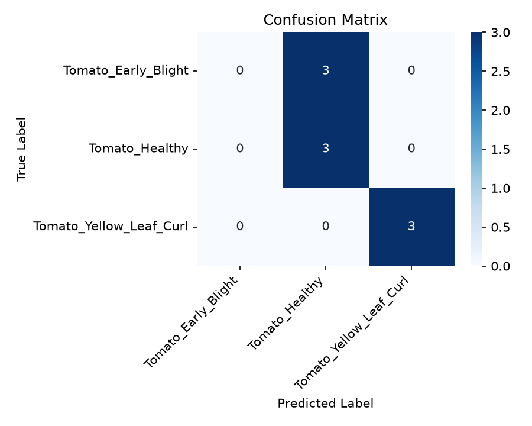

# Plant Disease Image Classification

[](https://colab.research.google.com/github/GaneshArwan/image_classification/blob/main/notebooks/03_colab_plantvillage_train.ipynb)

Leaf disease classifier comparing a from-scratch convolutional baseline against ResNet18 and EfficientNet-B0 transfer learning, paired with Grad-CAM spatial attribution and runtime input guardrails.

## Why This Exists
Crop disease diagnosis from field photos fails when models rely on background artifacts or accept unvalidated uploads. This pipeline pairs stratified evaluation across precision, recall, F1, and ROC-AUC with per-image Grad-CAM attribution so predictions can be inspected against actual leaf lesions before acting on them.

## Modeling & Pipeline Design
- **Architectures ([models.py](src/models.py)):** 3-block `BaselineCNN` (trained from scratch), `ResNet18`, and `EfficientNet-B0` with optional backbone freezing (`--freeze-backbone`).
- **Stratified Split & Augmentation ([data.py](src/data.py)):** Deterministic `StratifiedShuffleSplit` (70% train, 15% validation, 15% test) with ImageNet normalization and training-only geometric/color transforms (`RandomResizedCrop`, flips, rotation, `ColorJitter`).
- **Evaluation ([evaluate.py](src/evaluate.py)):** Accuracy, macro precision, macro recall, macro F1, macro OvR ROC-AUC, per-class F1, and labeled confusion matrices.
- **Visual Attribution ([gradcam.py](src/gradcam.py)):** Grad-CAM heatmap generation with automatic tensor-hook cleanup and RGB overlay blending.
- **Input & Serialization Guardrails ([schemas.py](src/schemas.py), [train.py](src/train.py)):**
  - Pydantic v2 bounds on training hyperparameters (`TrainConfig`) and checkpoint metadata (`CheckpointMetadata`).
  - Upload checks capping payload size (10 MB), pixel count (25M pixels, thread-safe Pillow limit), and formats (`JPEG`, `PNG`, `WEBP`).
  - Pure `state_dict` checkpoint persistence (`model_state.pt` loaded with `weights_only=True`) separated from JSON metadata (`metadata.json`).
  - Low-confidence warning flag when top predicted probability drops below 50%, localized in English (`en`) and Indonesian (`id`) via Babel ([i18n.py](src/i18n.py)).

## CPU Smoke Benchmark (3-Class Synthetic Dataset)
To verify the end-to-end training, evaluation, and Grad-CAM code paths without downloading external data, `src/data.py` includes a deterministic 3-class synthetic leaf generator (`Tomato_Healthy`, `Tomato_Early_Blight`, `Tomato_Yellow_Leaf_Curl`; 54 images split 37 train / 8 validation / 9 test).

Command executed:
```bash
python -m src.train --synthetic-demo --compare-all --epochs 2 --image-size 64 --no-pretrained --output-dir artifacts/smoke_run
```

| Architecture | Augmented | Accuracy | Macro Precision | Macro Recall | Macro F1 | Macro ROC-AUC | Test Samples |
|--------------|-----------|----------|-----------------|--------------|----------|---------------|--------------|
| `baseline_cnn` | `False` | 0.667 | 0.500 | 0.667 | 0.556 | 1.000 | 9 |
| `baseline_cnn` | `True` | 0.667 | 0.500 | 0.667 | 0.556 | 1.000 | 9 |
| `resnet18` | `False` | 0.333 | 0.111 | 0.333 | 0.167 | 0.889 | 9 |
| `resnet18` | `True` | 0.667 | 0.500 | 0.667 | 0.556 | 0.907 | 9 |

### Key Observations
1. Under a 2-epoch CPU budget from random initialization (`--no-pretrained`) on 37 training images, the 3-block `baseline_cnn` reached `0.667` accuracy (`0.556` macro F1, `1.000` macro OvR ROC-AUC), whereas unpretrained `resnet18` without augmentation collapsed to majority-class predictions (`0.333` accuracy, `0.167` macro F1).
2. Adding data augmentation stabilized `resnet18` from `0.333` to `0.667` accuracy (`0.167` to `0.556` macro F1; `0.889` to `0.907` ROC-AUC). Full 38-class PlantVillage runs require ImageNet pretrained weights (`--pretrained`, enabled by default) and 10+ epochs on GPU.

| Confusion Matrix (`resnet18_aug` smoke run) | Grad-CAM Overlay (`resnet18_aug` sample) |
|---|---|
|  |  |

## Quick Start

### Local Setup & Tests
```bash
pip install -r requirements.txt
pytest -v
```

### Run Interactive Streamlit App
```bash
streamlit run app.py
```
When no trained checkpoint directory is present on disk, `app.py` starts in demo mode with an explicit warning banner so upload validation and Grad-CAM rendering can still be tested.

### Train on PlantVillage (Local or Google Colab GPU)
1. Arrange class folders under `data/plantvillage/<class_name>/` (or open [notebooks/03_colab_plantvillage_train.ipynb](notebooks/03_colab_plantvillage_train.ipynb) in Google Colab).
2. Run comparison or single-backbone training:
```bash
python -m src.train --data-dir data/plantvillage --compare-all --epochs 10 --image-size 224
```

## Project Layout
- `src/schemas.py` — Pydantic v2 schemas and path/image validation guardrails
- `src/i18n.py` — Babel English/Indonesian localization
- `src/data.py` — Transforms, stratified splits, and synthetic leaf generator
- `src/models.py` — `BaselineCNN`, `ResNet18`, and `EfficientNet-B0` builders
- `src/gradcam.py` — Grad-CAM attribution and heatmap overlay
- `src/evaluate.py` — Multi-metric evaluation and confusion matrix plots
- `src/train.py` — CLI training/comparison runner and `weights_only=True` I/O
- `app.py` — Streamlit UI with upload guardrails and Grad-CAM view
- `notebooks/` — EDA (`01_eda.ipynb`), modeling (`02_modeling.ipynb`), and Colab GPU runner (`03_colab_plantvillage_train.ipynb`)
- `tests/` — Unit and end-to-end tests

## Limitations
- The metrics table above reflects the 3-class CPU synthetic smoke run (`--no-pretrained`, 64x64) rather than the 38-class PlantVillage dataset; full PlantVillage training requires GPU compute via [notebooks/03_colab_plantvillage_train.ipynb](notebooks/03_colab_plantvillage_train.ipynb).
- PlantVillage images were captured under controlled studio backgrounds; field photos with cluttered foliage, shadows, or unseen species can degrade accuracy and require fine-tuning on field-collected data.
